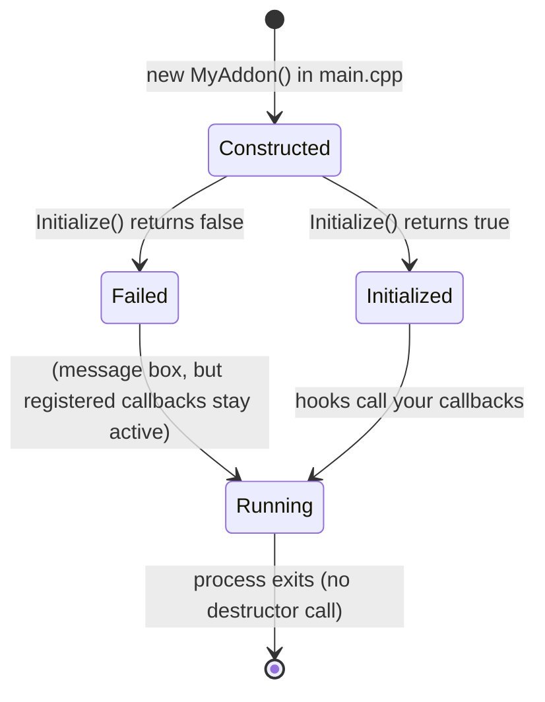

# Addon lifecycle

An addon goes through three stages: **constructed**, **initialized**, then **running** for the rest of the process. It's never shut down.



## Construction

The constructor runs in `InitThread`, after `Settings::Load()` but **before** `Engine::Initialize()`. At that point `GObjects` and `GNames` are still null. Don't touch the [generated SDK](game-sdk.md) or `Engine::Get*` in a constructor. Keep constructors trivial, as the built-in addons do (they have none).

## `Initialize()`

`Initialize()` runs after the engine hooks, the crash handler and the menu are set up, in the order the addons appear in `main.cpp`. This is where you:

- read your settings with [`Settings::GetSetting`](../api-reference/settings.md#getsetting);
- register callbacks with `Engine::On*` and [`Menu::OnVisibilityChange`](../api-reference/menu.md#onvisibilitychange);
- add menu tabs with [`Menu::AddTab`](../api-reference/menu.md#addtab);
- start any background threads you need. The multiplayer `Client` starts its network listener here.

Return `true` on success. Returning `false` only shows a message box. **Callbacks you registered before returning `false` stay registered and keep running.** Register them last if you might fail.

### Register only during `Initialize()`

Callback lists are plain `std::vector`s with no locking. Hooks are already live while `Initialize()` runs, so registering during `Initialize()` already overlaps with the game iterating those lists (see [code issues](../_notes/code-issues.md)). Registering later, from inside a callback or another thread, makes the race worse. You also **can't unregister** a callback, so register once and gate behaviour with your own flags:

```cpp
static bool Enabled = false;

static void OnTick(float delta) {
    if (!Enabled) {
        return;
    }
    // ...
}
```

## Running

From here on, your code runs only when a hook calls it. The [callbacks page](callbacks-and-threads.md) lists each one. State is usually kept in file-scope `static` variables, as in all the built-in addons.

## No teardown

The framework never deletes addons (the `addons` array in `main.cpp` is leaked on purpose), never unhooks, and has no unload path. Anything you allocate lives until the game exits. To pick up code changes, restart the game; see [Iterating](../getting-started/building.md#iterating).

Related: [Architecture](architecture.md) · [`Addon` reference](../api-reference/addon.md)
