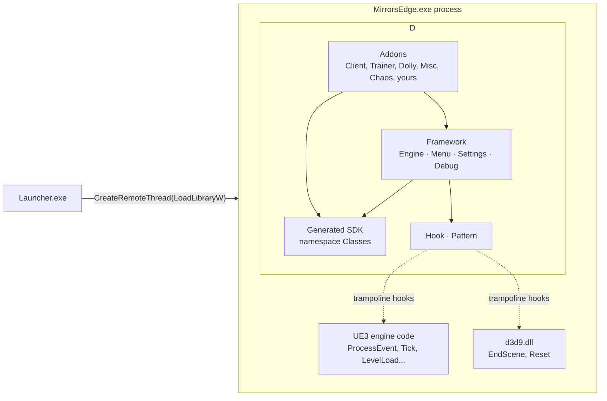

# Architecture

This page shows how your addon code ends up running inside the game.

## Components



- **Launcher** (`Launcher/main.cpp`) waits for `MirrorsEdge.exe` to load `d3d9.dll`, then injects `mmultiplayer.dll` from its own directory.
- **Generated SDK** (`Client/sdk/`): C++ layouts of the game's UnrealScript classes. Its function wrappers call the engine's `ProcessEvent`. See [The game SDK](game-sdk.md).
- **Framework** (`Client/engine.*`, `menu.*`, `settings.*`, `debug.*`) hooks engine and Direct3D functions and fans each hook out to the callbacks that addons register.
- **Hook / Pattern** (internal): `Pattern::FindPattern` locates engine functions by byte signature, and `Hook::TrampolineHook` patches a `jmp` into each one.
- **Addons** use only the framework and the SDK.

## Startup sequence

`DllMain` starts `InitThread` on a new thread (`Client/main.cpp`):

```mermaid
sequenceDiagram
    participant T as InitThread
    participant E as Engine
    participant S as Settings
    participant M as Menu
    participant A as Addons
    T->>E: InitializeD3D()
    Note right of E: hook LoadLibraryA/W/ExW,<br/>Direct3DCreate9 → CreateDevice → EndScene/Reset
    T->>S: Load()
    T->>A: new Client(), new Trainer(), ... (constructors)
    T->>E: Initialize()
    Note right of E: pattern-scan GNames, GObjects;<br/>hook PeekMessageW, ProcessEvent, LevelLoad,<br/>PreDeath, PostDeath, ActorTick, BonesTick,<br/>ProjectionTick, Tick
    T->>T: Debug::Initialize() (crash handler)
    T->>M: Initialize() (Engine + World tabs, menu key)
    loop each addon
        T->>A: Initialize()
    end
```

Failure handling:

- If `InitializeD3D`, `Engine::Initialize` or `Menu::Initialize` fails, you get a "Fatal" message box and nothing else starts. In the last two cases the addon objects are deleted.
- If an addon's `Initialize()` returns `false`, you get `Failed to initialize "<GetName()>"`, and startup continues with the next addon.

After `InitThread` returns, everything runs from inside the hooks. The framework never unhooks and never destroys addons. The one exception is temporary unhooking for `menl_hooks.dll`, described below.

## Hooked functions

| Hook | Located by | Drives |
|---|---|---|
| `IDirect3DDevice9::EndScene` | vtable of the game's device (found by hooking `Direct3DCreate9`/`CreateDevice`, with a probe-device fallback) | ImGui frame, `OnRenderScene` |
| `IDirect3DDevice9::Reset` | same | ImGui device objects |
| `PeekMessageW`, window procedure | trampoline on `PeekMessageW`; `SetWindowLongPtr` subclass | `OnInput`, `OnSuperInput`, `BlockInput` |
| `UObject::ProcessEvent` | pattern | `OnProcessEvent` |
| Level load | pattern | `OnPreLevelLoad`, `OnPostLevelLoad` |
| Pre/post death | pattern | `OnPreDeath`, `OnPostDeath` |
| Actor tick | pattern | `OnActorTick` |
| Bones tick | pattern | `OnBonesTick` |
| Projection | pattern | `WorldToScreen` (stores the projection matrix) |
| Engine tick | pattern | `OnTick`, command and spawn queues |

### Compatibility shims

- **Mirror's Edge Tweaks** (`menl_hooks.dll`). When the game loads this DLL, the framework temporarily removes its level-load and death hooks so the tweak can install its own. A background thread then re-applies them once the tweak's `jmp` is in place.
- **Softimer**. Objects of class `MirrorsEdgeTweaksScripts.SofTimerPlayerController` count as the player controller, alongside `TdGame.TdPlayerController`.

Related: [Addon lifecycle](addon-lifecycle.md) · [Callbacks and threads](callbacks-and-threads.md)
