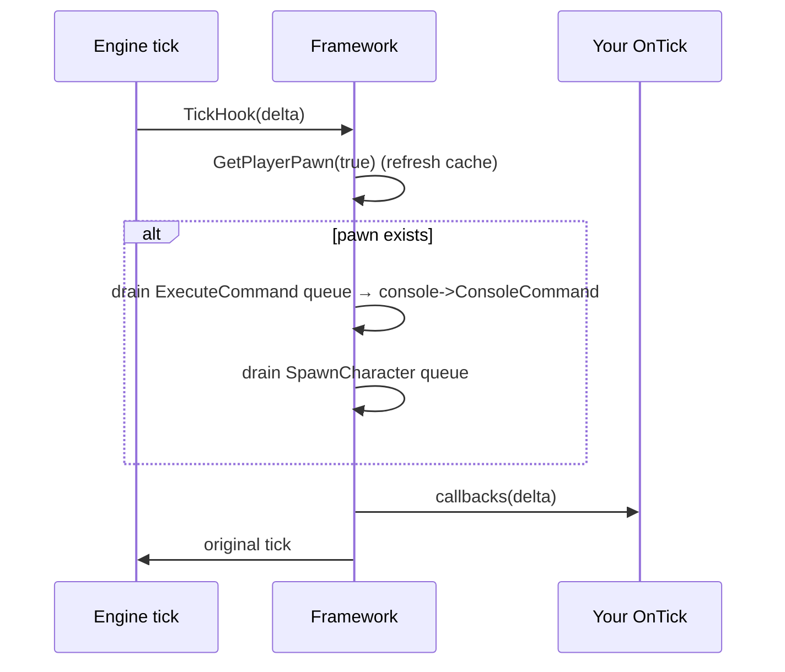

# Callbacks and threads

Every callback is a **plain function pointer**. You can pass a free function or a lambda **with no captures**. A capturing lambda doesn't convert to a function pointer, and the compiler rejects it.

All callbacks of one kind run **in registration order**. Registration is append-only: you can't remove a callback. Register in `Initialize()` (see [Addon lifecycle](addon-lifecycle.md#register-only-during-initialize)).

## When each callback fires

| Register with | Signature | Fires | Notes |
|---|---|---|---|
| `Engine::OnTick` | `void(float delta)` | Once per engine tick | Runs **after** the console-command and spawn queues drain. `delta` is the engine's tick delta. <!-- TODO: verify units (seconds, presumably) --> |
| `Engine::OnRenderScene` | `void(IDirect3DDevice9 *device)` | Once per `EndScene` | Runs between `ImGui::NewFrame()` and `ImGui::EndFrame()`, so ImGui calls are valid. Menu tabs are drawn from a render callback too. |
| `Engine::OnActorTick` | `void(Classes::AActor *actor)` | Once per **actor** per tick, before that actor's native tick | High frequency. Filter by pointer as fast as you can. `actor` can be null. |
| `Engine::OnBonesTick` | `void(Classes::TArray<Classes::FBoneAtom> *atoms)` | After any skeletal mesh computes its bone atoms | Only called when `atoms->Num() > 0`. Match `atoms->Buffer()` against `SkeletalMeshComponent->LocalAtoms.Buffer()` to find the mesh. |
| `Engine::OnProcessEvent` | `bool(UObject *object, UFunction *function, void *args, void *result)` | Before every `UObject::ProcessEvent` | Return `true` to **block** the event. See [Intercepting script events](../guides/intercepting-events.md). |
| `Engine::OnPreLevelLoad` | `void(const wchar_t *levelName)` | Before the engine loads a level | Accessors start returning `nullptr` right after. |
| `Engine::OnPostLevelLoad` | `void(const wchar_t *levelName)` | After the load function returns | Same `levelName` as the pre callback. |
| `Engine::OnPreDeath` / `OnPostDeath` | `void()` | Around the engine's death/respawn routine | |
| `Engine::OnInput` | `void(unsigned int &msg, int keycode)` | On key-down/key-up **transitions** | Not called while input is blocked (menu open). |
| `Engine::OnSuperInput` | same | Same, but **also** while input is blocked | Use for keys that must work with the menu open. |
| `Menu::OnVisibilityChange` | `void(bool show)` | When `Menu::Show()` / `Menu::Hide()` run | |
| `Menu::AddTab` | `void()` | Every frame while that tab is selected and the menu is open | |

Exact signatures and typedef names are in the [callbacks reference](../api-reference/engine-callbacks.md).

### Input details

- Only `WM_KEYDOWN`, `WM_SYSKEYDOWN`, `WM_KEYUP` and `WM_SYSKEYUP` are reported, and only when the key's state changes, so holding a key doesn't auto-repeat. `keycode` is the Win32 virtual-key code (`VK_*`, plus the letters and digits in `util.h`).
- `msg` is passed by reference, and **changing it changes what the game receives**. On the `PeekMessageW` path it aliases `MSG::message`; on the window-procedure path it's the value forwarded to the game's original window procedure. In principle, setting it to `WM_NULL` swallows the message. No built-in addon does this, and later callbacks in the same dispatch see your change. <!-- TODO: verify this is an intended, supported use -->
- Super-input callbacks run first, then normal ones.

## Order within a tick

So a command you queue with `ExecuteCommand` in tick *N* runs at the start of tick *N+1*, and only if a player pawn exists.

## Threads

The framework calls you from several contexts:

| Context | Callbacks |
|---|---|
| `InitThread` (created by `DllMain`) | Your constructor and `Initialize()` |
| The game's engine thread | `OnTick`, `OnActorTick`, `OnBonesTick`, `OnProcessEvent`, level-load and death callbacks |
| The thread that calls `EndScene` | `OnRenderScene`, menu tabs |
| The thread pumping window messages | `OnInput`, `OnSuperInput` |

<!-- TODO: verify whether EndScene and the message pump run on the same thread as the engine tick in Mirror's Edge. This decides whether reads/writes from render callbacks race the game. -->

What's known from the code:

- The framework's own comment in `TickHook` says queued commands and spawns "must be executed inside the context of an engine thread in sync with a tick". It's safest to **change game state from `OnTick`** and only read it in render callbacks, as the multiplayer and dolly addons mostly do.
- The built-in addons do read game objects from `OnRenderScene` and write some (for example, the World tab edits `TimeDilation` directly).
- If you share data between your own callbacks and your own threads, protect it yourself. The `Client` addon uses a `std::shared_mutex` for its player list.

Related: [Architecture](architecture.md) · [Object accessors](object-accessors.md)
