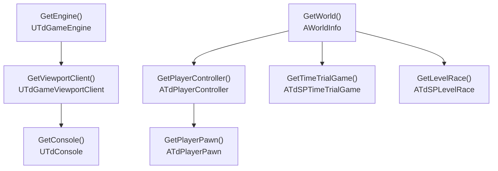

# Object accessors

The `Engine::Get*` functions are how you reach the game's main objects without scanning `GObjects` yourself.



Each arrow means "resolved from". `GetPlayerPawn` asks `GetPlayerController`, which asks `GetWorld`.

## How they resolve

| Accessor | Resolved by |
|---|---|
| `GetEngine` | Scans `GObjects` for a `UTdGameEngine` whose `Outer` is named `Transient` |
| `GetViewportClient` | `engine->GameViewport` |
| `GetConsole` | `viewportClient->ViewportConsole` |
| `GetWorld` | Scans `GObjects` for an `AWorldInfo` whose `ControllerList` contains a player controller (`TdPlayerController`, or Softimer's controller) |
| `GetPlayerController` | Walks `world->ControllerList` for that controller; returns `nullptr` if its `PlayerCamera` is still null |
| `GetPlayerPawn` | `controller->AcknowledgedPawn` |
| `GetTimeTrialGame` / `GetLevelRace` | `world->Game`, if its name contains `TdSPTimeTrialGame` / `TdSPLevelRace` |

## Caching and the `update` flag

Every accessor stores its result in a **function-local static** and returns the cached pointer on later calls. Pass `update = true` to force it to resolve again. `update` propagates down the chain: `GetPlayerPawn(true)` also refreshes the controller and the world.

- `GetEngine(true)` and `GetWorld(true)` **scan every object** in `GObjects`. Don't call them every frame.
- The framework calls `GetPlayerPawn(true)` at the start of **every tick**. So `GetPlayerPawn()`, `GetPlayerController()` and `GetWorld()` with no argument are already fresh as of the current tick, and you rarely need `update = true` for them.
- `GetEngine`, `GetViewportClient` and `GetConsole` only refresh when you ask. These objects live for the whole session, so that's normally fine.
- If the first lookup of `GetEngine`, `GetViewportClient` or `GetConsole` fails, they keep retrying on later calls until they find something.

## `nullptr` cases

**Always null-check the result.** The accessors return `nullptr`:

- **while a level is loading**: `GetWorld`, `GetPlayerController`, `GetPlayerPawn`, `GetTimeTrialGame` and `GetLevelRace` return `nullptr` between the pre- and post-level-load callbacks, whatever is cached;
- when no player controller exists yet, for example during early startup;
- `GetPlayerController`, while the controller's `PlayerCamera` is still null;
- `GetTimeTrialGame` / `GetLevelRace`, when the current game mode isn't a time trial or a level race.

A cached pointer can also go **stale** after a level change. That's another reason to fetch it each time you need it rather than storing it in your own static.

## Example

```cpp
static void OnTick(float delta) {
    const auto pawn = Engine::GetPlayerPawn();
    const auto controller = Engine::GetPlayerController();
    if (!pawn || !controller) {
        return;
    }

    // ... safe to use pawn and controller for this tick
}
```

Reference: [Engine accessors](../api-reference/engine-accessors.md) · Guide: [Reading player state](../guides/reading-player-state.md)
