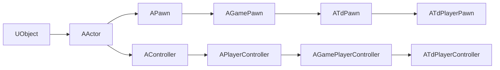

# Finding game classes and functions

The generated SDK has no index. It's about 15 MB of headers, so search it.

## Where to look

| You want | Search |
|---|---|
| A class's fields and methods | `Client/sdk/ME_<Pkg>_classes.hpp` for `^class A<Name>` / `^class U<Name>` |
| A struct or enum | `Client/sdk/ME_<Pkg>_structs.hpp` for `^struct F<Name>` / `^enum class E<Name>` |
| A function's exact parameters | `Client/sdk/ME_<Pkg>_parameters.hpp` for `<Class>_<Function>_Params` |
| A function's UnrealScript name and flags | `Client/sdk/ME_<Pkg>_functions.cpp`. Each wrapper starts with `// Function TdGame.TdPlayerPawn.Landed` and a flags line such as `(Defined, Event, Public)` |

Start with **TdGame** (Mirror's Edge gameplay, `Td` prefix), then **Engine** (generic UE3).

```bash
# Every class that derives from ATdPawn
grep -n ": public ATdPawn" Client/sdk/ME_TdGame_classes.hpp

# Which class declares a field
grep -n "EnterFallingHeight" Client/sdk/ME_*_classes.hpp

# Full names of the player pawn's script functions
grep -o '"Function TdGame.TdPlayerPawn\.[A-Za-z]*"' Client/sdk/ME_TdGame_functions.cpp
```

The field comments give the offset and size, for example `// 0x00E8(0x000C)`, plus UnrealScript property flags. `Edit` means editable in the editor, `Net` means replicated, and `Transient` means not saved.

## Inheritance

Each class header begins `class ATdPlayerPawn : public ATdPawn`, and so on up to `UObject`. A field you can't find on a class is usually declared on an ancestor: `Location` is on `AActor`, `Health` is on `APawn`. The common chain:



## Finding live objects at runtime

When you need an object that no accessor gives you, scan `GObjects` once and cache the result:

```cpp
#include "../engine.h"

static Classes::ATdSPTimeTrialGame *FindTimeTrial() {
    const auto &objects = Classes::UObject::GetGlobalObjects();
    for (auto i = 0UL; i < objects.Num(); ++i) {
        const auto object = objects.GetByIndex(i);
        if (object && object->IsA(Classes::ATdSPTimeTrialGame::StaticClass())) {
            return static_cast<Classes::ATdSPTimeTrialGame *>(object);
        }
    }
    return nullptr;
}
```

This is how `Engine::GetEngine` and `Engine::GetWorld` work internally. `GObjects` also contains class default objects ("Default__..." names) and objects from other loaded levels, so filter as tightly as you can. `Engine::GetEngine`, for example, also checks the outer's name. To find an object by exact full name, use `Classes::UObject::FindObject<T>("Class Package.Outer.Name")`.

## Debugging

- Open the debug console with **Engine tab > Debug Console**. Anything you `printf` shows up there.
- Print `object->GetFullName()` to learn an object's class and path.
- The World tab shows streaming levels. The Engine tab has a console-command box and edits `UTdGameEngine` frame-smoothing fields (`bSmoothFrameRate`, `MinSmoothedFrameRate`, `MaxSmoothedFrameRate`).
